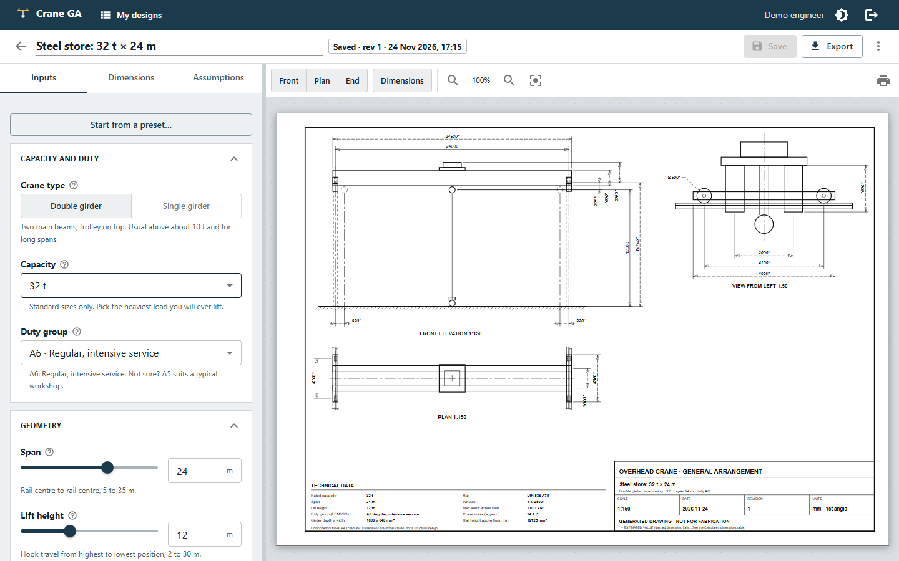
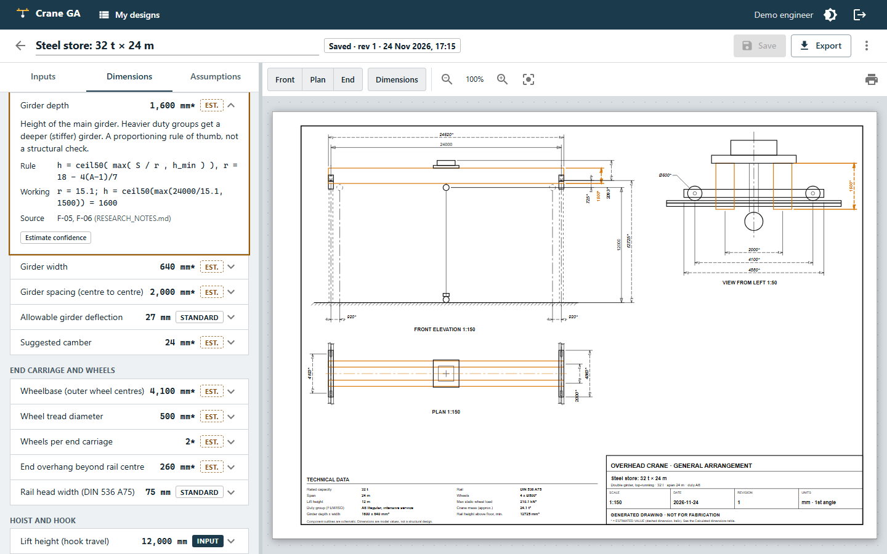
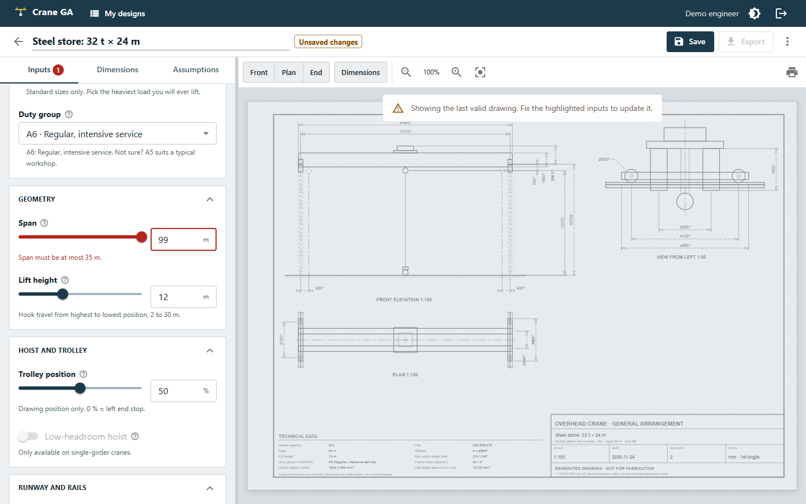
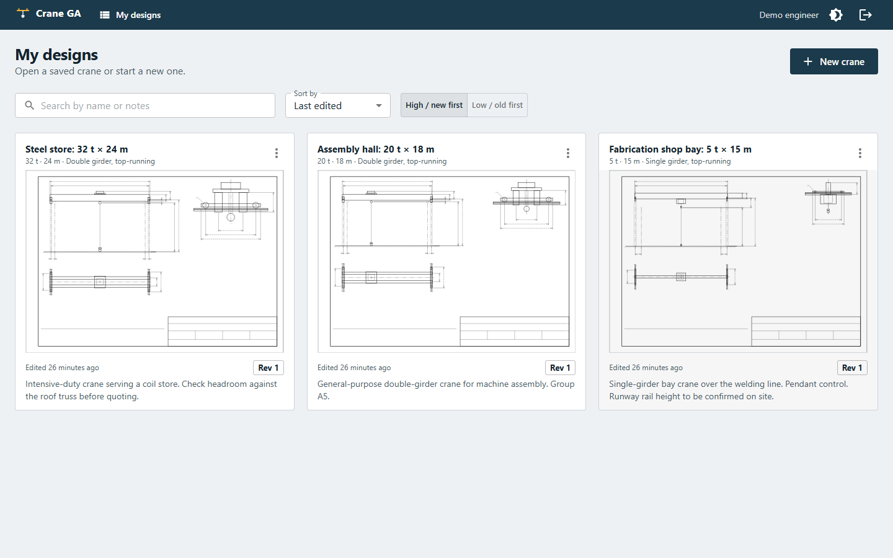

# Crane GA: parametric overhead crane drawing generator

Pick a capacity, span, lift height and duty group; get a dimensioned general-arrangement (GA) sheet of a top-running overhead (EOT) crane: front elevation, plan and end view on an A3 sheet with a title block. Save designs, reopen and edit them, export PDF / SVG / DXF / PNG.

Built for the Modern Crane Co take-home. The point of the project is *honesty about the domain*: every derived dimension carries its formula, its source and a confidence level, and anything that is an estimate is marked `*` on the drawing itself. Read [RESEARCH_NOTES.md](RESEARCH_NOTES.md) for what was researched, what each rule is based on, and what is still a guess.

| | |
|---|---|
|  |  |
|  |  |

*Top right: hovering a row in "Dimensions" lights up the part in all three views and shows its formula. Bottom left: invalid input keeps the last good drawing, dimmed, and says how to fix it.*

> **Time spent:** _to be filled in by the author_ (the brief asks for the real hours here).

## Quick start (local)

Needs **Node 22** (`.nvmrc`; 20.12+ also works) and a PostgreSQL database.

```bash
npm run setup     # npm install, create .env files, start Postgres (Docker), migrate, seed the demo account
npm run dev       # web http://localhost:5173  ·  api http://localhost:4000
```

* **No Docker?** In a second terminal run `npm run db:embedded` (a real PostgreSQL started from an npm package, same port and credentials as the compose file), then `npm run setup`.
* **Want Neon (or any Postgres)?** Put your connection strings in `apps/api/.env` (`DATABASE_URL`, `DIRECT_URL`) before `npm run setup`. No Neon account is needed to run locally.
* **Demo login:** `demo@example.com` / `CraneDemo2026!`, or click **Try the demo** on the login page (three sample cranes are seeded).

Verified from a clean copy of the repository (no `node_modules`, no `.env`): install, setup, lint, type-check, all tests, production build, dev servers and the end-to-end test all pass.

### Scripts

| Command | What it does |
|---|---|
| `npm run setup` | install, create `.env` files, start the local DB, apply migrations, seed demo data |
| `npm run dev` | API (tsx watch) and web (Vite) together |
| `npm run build` / `npm start` | production build of API and web / run the built API |
| `npm test` | unit and integration tests of all workspaces (the API tests start their own throwaway PostgreSQL) |
| `npm run test:e2e` | Playwright journey in a real browser (needs the DB running and migrated) |
| `npm run lint` · `npm run typecheck` | ESLint · strict `tsc` in every workspace |
| `npm run db:up` / `db:down` / `db:embedded` | Postgres via Docker Compose / stop it / Postgres without Docker |
| `npm run db:migrate` / `db:seed` | create a new migration (dev) / reset and seed the demo user |

### Environment variables

`apps/api/.env.example` and `apps/web/.env.example` are pre-filled for the local database. The API validates its environment at boot and exits with a list of every problem.

| Variable | Where | Meaning |
|---|---|---|
| `DATABASE_URL` | api | Runtime connection. On Neon: the **pooled** string (host contains `-pooler`) |
| `DIRECT_URL` | api | Used by `prisma migrate` and the seed. On Neon: the **direct** (non-pooled) string |
| `JWT_SECRET` | api | 32+ characters. A development placeholder is refused when `NODE_ENV=production` |
| `JWT_EXPIRES_IN` | api | Token lifetime, default `12h` |
| `CORS_ORIGINS` | api | Comma-separated browser origins allowed to call the API |
| `TRUST_PROXY` | api | Reverse proxies in front of the API (Render: `1`) so rate limiting sees real client IPs |
| `PORT`, `LOG_LEVEL`, `BCRYPT_COST`, `NODE_ENV` | api | Defaults `4000`, `info`, `12`, `development` |
| `VITE_API_URL` | web | API base URL, no trailing slash (default `http://localhost:4000`) |

## What it does

**Crane scope:** top-running EOT, **double girder** (trolley on top of the girders) and **single girder** (hoist hangs below; optional low-headroom hoist, as in the company sample). Capacity from the IS 3177 preferred series (1 to 50 t), span 5 to 35 m, lift height 2 to 30 m, duty group A1 to A8, DIN 536 rail (auto or chosen).

**Drawing:** front elevation, plan and end view in first-angle projection on an A3 sheet (ISO-style frame, title block with revision/date/scale/units and a *generated drawing, not for fabrication* note, technical-data table, estimate legend). Dimension lines have extension lines and arrowheads; labels are stacked in lanes so they never overlap (this is tested). The scale is chosen automatically and printed.

**Honesty built in:**
* each calculated dimension is `INPUT`, `STANDARD` or `EST.`; estimates are drawn with dashed dimension lines, italic text and a `*`
* the **Dimensions** panel shows the rule, the working with this design's numbers, the source ID (into RESEARCH_NOTES.md) and a confidence level
* the **Assumptions** panel lists everything that shapes the drawing but is not an input
* two validation tiers: **errors** block saving, **warnings** do not; messages say how to fix and point at the field

**Editor:** live preview (the same engine runs in the browser and on the server), presets, slider plus numeric field, plain-language tooltips for jargon, resizable split (tabs on tablet/mobile), zoom/pan/fit, view and dimension toggles, hover linking between drawing and table, dirty indicator, unsaved-changes guard, session draft recovery, optimistic-concurrency conflict dialog, save-as-copy, delete with confirmation, retryable error messages, a "waking up the server" state for sleeping free-tier hosts, light/dark themes, print stylesheet (A3 landscape), keyboard operable with labelled controls and aria-live announcements.

## Architecture

```
packages/shared    Zod schemas + the parametric engine (pure TypeScript, no I/O)
  schema.ts          inputs, API payloads, text sanitising          validate.ts   two-tier validation
  model.ts           inputs -> derived dimensions with provenance   views.ts      front / end / plan geometry
  dimensions.ts      dimension lanes and label placement            sheet.ts      A3 sheet, scale choice, title block
  scene.ts           drawing primitives (single source of truth)    svg.ts dxf.ts renderers
apps/api           Express 4, Prisma 6, PostgreSQL (Neon), JWT, pdfkit
apps/web           React 18, Vite, MUI 6 (custom theme), React Query
```

The engine turns validated inputs into a `CraneModel` (every number with formula, source, confidence), builds geometry primitives in sheet millimetres, and the **same primitives** are rendered to SVG (browser and file), PDF (vector, server) and DXF. So the drawing on screen, the PDF and the CAD file cannot disagree. Client and server import the same `analyze()` function: the browser gives instant feedback, the server stays authoritative and re-validates everything.

Data model: `User` and `Design` (`inputs` JSON, `schemaVersion`, `revision` for optimistic concurrency, `capacityT`/`spanM` denormalised for sorting). Saving is an atomic compare-and-set on `revision`; a stale save gets `409` with the current version.

## API

Base path `/api/v1`. JSON in and out; errors are RFC 7807 `application/problem+json` with a `code` and per-field `errors: [{ path, severity, code, message, hint }]`.

| Method and path | Auth | Purpose |
|---|---|---|
| `GET /health` | no | liveness plus a database check (`503` if the DB is down) |
| `POST /auth/register` · `POST /auth/login` · `GET /auth/me` | no / no / yes | accounts (bcrypt, 12 h JWT, HS256 only) |
| `GET /designs?q&sort&order&page&pageSize` | yes | my designs: search, sort (`updatedAt createdAt name capacityT spanM`), pagination |
| `POST /designs` | yes | create (name, notes, inputs) |
| `GET` · `PUT` · `DELETE /designs/:id` | yes | read (with re-validation issues) · update with `revision` · delete |
| `POST /designs/:id/duplicate` | yes | copy |
| `GET /designs/:id/export/{svg,pdf,dxf}` | yes | export a saved design |
| `POST /render` | no | validate and return derived dimensions, assumptions and the drawing SVG; stores nothing |
| `POST /export/{svg,pdf,dxf}` | no | export unsaved inputs (what the editor does) |

Status codes: `400` malformed or out-of-range values, unknown fields, bad JSON · `401` no/invalid/expired token or bad credentials · `403` someone else's design · `404` unknown design or route · `409` stale `revision` or duplicate email · `413` body over 100 kB · `422` well-formed but breaks an engineering rule (for example a 32 t single girder) · `429` rate limit · `503` database unreachable.

Security and robustness: helmet, CORS allow-list from env, 100 kB body limit, rate limits (login 10 failed attempts per 15 min; render/export 60 per minute; register 20 per hour), unknown fields rejected, nothing clamped silently, names and notes stripped of control characters and escaped on every output, bcrypt hashing, equal-time login failure, designs scoped to the owner on every route, request logging with the `Authorization` header redacted, no stack traces in responses, fail-fast env validation, graceful shutdown, DB connection retry with backoff for Neon cold starts.

## Tests

| Suite | Count | What it covers |
|---|---|---|
| `packages/shared` (Vitest) | 130 | every input boundary and type, each cross-field rule, calibration against the company sample, rules over a 600+ design grid (no negative or inverted geometry, wheelbase ≥ span/8, dimensions add up), 12 drawing sheets (nothing outside the frame, views do not overlap, **no overlapping text**, printed values equal model values), DXF parsed back, SVG escaping, snapshots |
| `apps/api` (Vitest + Supertest, real PostgreSQL) | 40 | every failure class: 400/401/403/404/409/413/422/429/503, client-validation bypass (strings, `null`, `1e308`, `__proto__`, extra fields), HTML/SQL in names, other users' ids, tampered/expired/`alg:none`/wrong-key tokens, two simultaneous edits (exactly one wins), exports (PDF header and A3 size, DXF parse-back), env validation, Neon retry logic |
| `apps/web` (Testing Library) | 18 | form validation display and accessibility attributes, save → reopen → edit → save flow, conflict dialog, unsaved-changes guard, draft recovery |
| `apps/web/e2e` (Playwright) | 2 | register → create → adjust → save → reload → reopen → edit → save → export PDF/SVG/DXF/PNG → delete; and cross-account access denied |

## Deploying to Render + Neon

Nothing here is deployed for you; these are the exact manual steps. `render.yaml` is a Blueprint with an API web service and a static site.

**1. Neon (database)**
1. Create a project (choose a region close to Render's, e.g. Frankfurt ↔ AWS eu-central-1).
2. In **Connection Details**, with *Connection pooling* **on**, copy the string: this is `DATABASE_URL` (host contains `-pooler`).
3. Switch pooling **off**, copy the string again: this is `DIRECT_URL` (migrations need a direct, session-level connection).
4. Both end in `?sslmode=require`; keep that.

**2. Render**
1. Push this repository to GitHub.
2. Render dashboard → **New → Blueprint** → select the repository. Render reads `render.yaml` and proposes `crane-api` and `crane-web`.
3. Fill the variables Render asks for (`sync: false` in the file):
   * `crane-api`: `DATABASE_URL`, `DIRECT_URL`, and `CORS_ORIGINS` = the static site's URL, e.g. `https://crane-web.onrender.com` (no trailing slash). `JWT_SECRET` is generated for you.
   * `crane-web`: `VITE_API_URL` = the API's URL, e.g. `https://crane-api.onrender.com` (no trailing slash). It is read at build time, so changing it needs a rebuild.
4. Deploy. The API build installs, compiles, runs `prisma migrate deploy` (over `DIRECT_URL`) and seeds the demo account; the service then starts with the pooled `DATABASE_URL`. Health check: `/api/v1/health`.
5. If the service URLs differ from the ones you guessed, correct `CORS_ORIGINS` and `VITE_API_URL` and redeploy both.
6. Open the web URL and click **Try the demo**.

Notes: free web services sleep after about 15 minutes idle, so the first request takes 30 to 60 seconds; the UI shows "Waking up the server…" while it waits. Free services have no pre-deploy hook, which is why migrations run in the build step. The seed resets the demo user's designs on every deploy.

## Folder map

```
apps/api/        src/ (app, auth, routes, pdf, db, env, errors)  prisma/ (schema, migrations, seed)  tests/
apps/web/        src/ (pages, components, editor, api, auth, lib, test)  e2e/
packages/shared/ src/ (engine and its tests)
scripts/         setup.mjs  embedded-db.mjs
docs/screenshots/
docker-compose.yml  render.yaml  RESEARCH_NOTES.md  AI_LOG.md
```

## Known limitations

* **Almost every derived dimension is an estimate**, calibrated to one company drawing and a few manufacturer tables, not a standard. This is a layout and proposal tool, not a structural design check. The ten questions at the end of RESEARCH_NOTES.md are what an engineer at Modern Crane Co would need to answer to make it trustworthy.
* Not covered: under-running cranes, cabs, gantry cranes, twin hoists, structural/deflection checks, electrical data, a building outline.
* Component outlines (hoist, hook, end carriage) are schematic.
* DXF is the sheet as plotted (lines and text, not associative CAD dimensions). Intermediate drawing scales (1:75, 1:125, …) are not ISO-preferred scales.
* One 12-hour JWT, no refresh token. The demo account is shared by everyone who tries it.
* No pinch-to-zoom on touch screens (zoom buttons and drag-to-pan work).
* The web bundle is a single ~240 kB (gzip) chunk; no code splitting.
